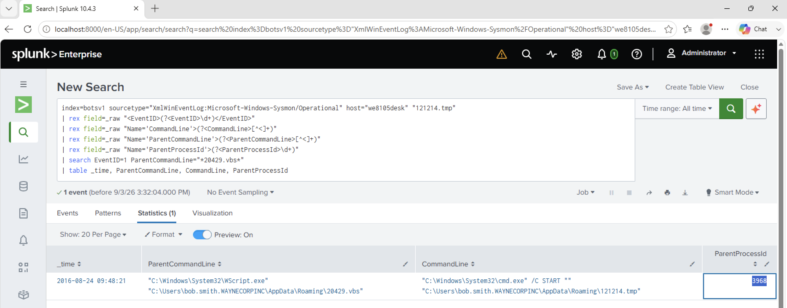
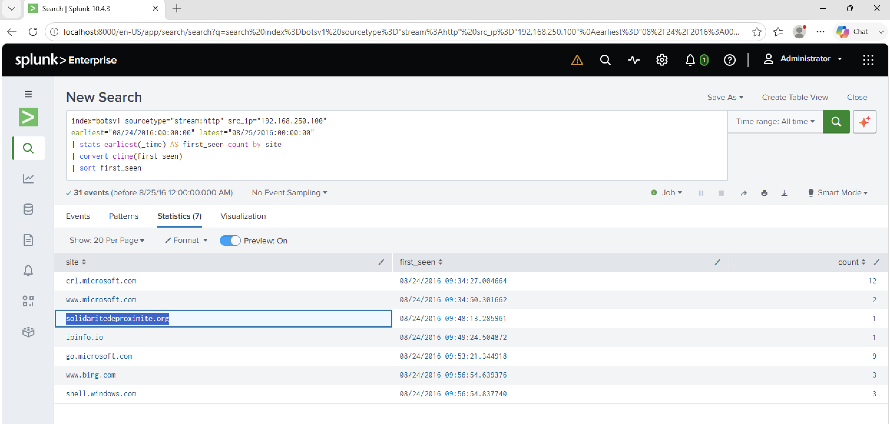
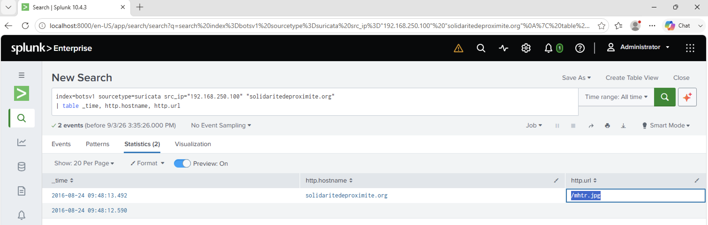
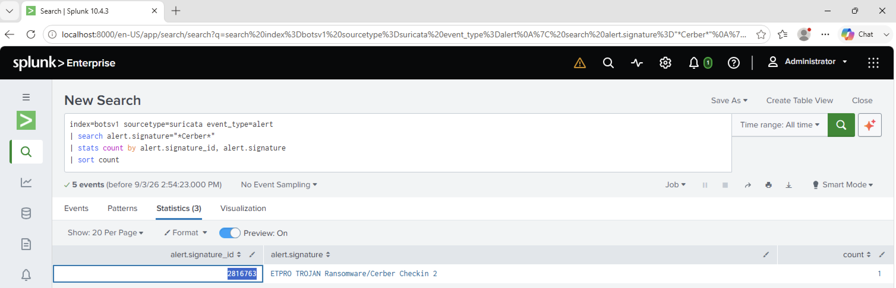
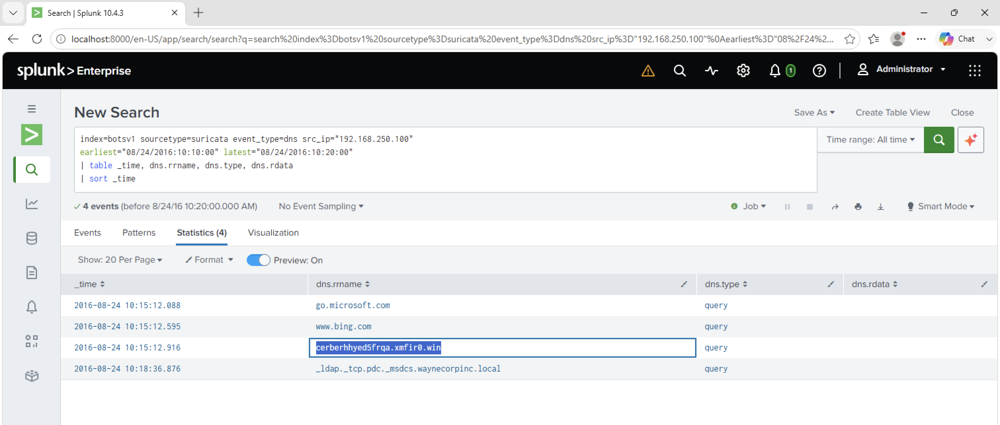
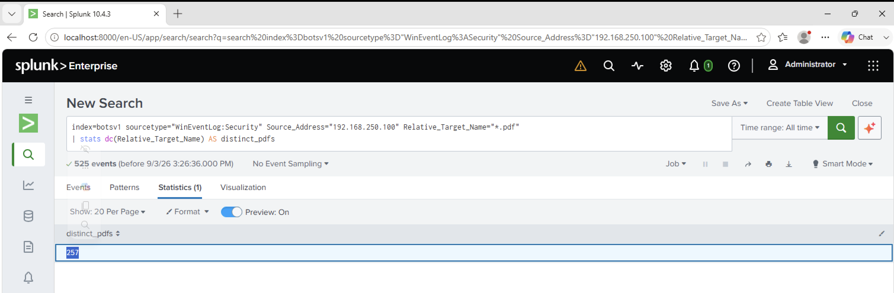
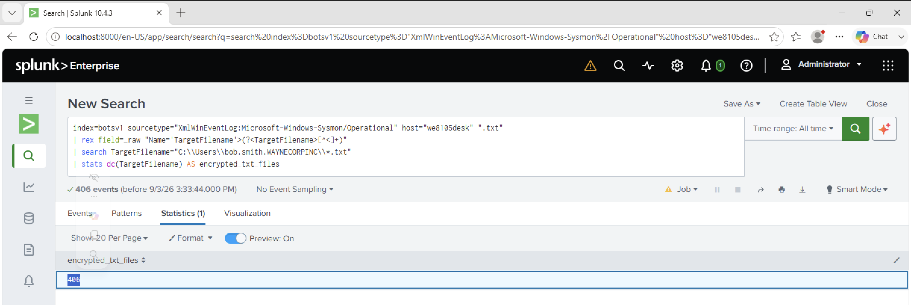

# End-to-End Cerber Ransomware Investigation

> **Environment:** Splunk Boss of the SOC (BOTS) v1 training dataset  
> **Host:** `we8105desk` (`192.168.250.100`)  
> **Date in dataset:** 24 August 2016  
> **Assessment:** Malicious Cerber ransomware activity observed in the simulated environment  
> **Scope note:** This report consolidates my previously documented BOTS v1 searches and evidence in this repository. It is a synthesis of that lab work, not a claim that the dataset was freshly ingested for this report.

## Executive summary

I correlated Windows Sysmon, HTTP, DNS, Suricata, SMB, and Windows Security evidence for the simulated workstation `we8105desk`. The records show suspicious VBScript execution, a request to infrastructure associated with the Cerber activity, a Cerber-related DNS lookup, and file activity affecting the workstation and a remote file server.

The lab notes identify `mhtr.jpg` as the downloaded file associated with the Cerber encryptor. Separate Windows event searches counted 406 distinct `.txt` paths in the user's profile and 257 distinct `.pdf` paths accessed on the file server during the ransomware activity. Those counts indicate scope in the dataset; the underlying event counts alone do not independently prove each file's final encryption state.

This is a public training scenario. It does not describe a customer incident or a live system.

## Evidence-based timeline

Times below are the values recorded in the existing Splunk investigation notes. The source notes do not establish the display timezone, so treat them as dataset/Splunk display times rather than UTC.

| Time on 24 Aug 2016 | Observation | Source |
|---|---|---|
| ~09:43:21 | A suspicious, unusually long command line containing VBScript content was observed on `we8105desk`. The extracted command line was 4,490 characters. | [VBScript analysis](23-vbscript-command-length.md) |
| ~09:48:13 | `we8105desk` first contacted the suspicious domain `solidaritedeproximite.org`. | [Domain pivot](22-first-suspicious-domain.md) |
| ~10:15 | A Cerber-related Suricata alert and an Onion-domain DNS lookup were observed; the workstation queried `cerberhhyed5frqa.xmfir0.win`. | [Suricata signature](20-cerber-suricata-signature.md), [DNS pivot](21-cerber-ransomware-fqdn.md) |
| During the ransomware activity | Windows Security and Sysmon searches returned 257 distinct PDF paths on the remote file server and 406 distinct TXT paths in the user's profile. | [PDF count](26-distinct-pdf-files-encrypted.md), [TXT count](28-cerber-txt-files-encrypted.md) |

The times are kept as recorded in the individual notes; they have not been normalized across data sources. Correlate raw event timestamps and timezone settings before using this timeline for precise sequencing.

## Investigation

### 1. Establish the host and process context

Earlier host triage identified `we8105desk` as `192.168.250.100`. Sysmon process-creation events linked `WScript.exe` running `20429.vbs` to the launch of `121214.tmp`; the recorded ParentProcessId for that launch was `3968`.

This is suspicious execution context, but a process name or parent relationship alone is not enough to determine payload behavior. I correlated it with network and file activity before assessing the case.



### 2. Pivot from the endpoint to network activity

I grouped the workstation's HTTP activity by site and first-seen time. After ordinary Microsoft domains, the first domain noted as suspicious was `solidaritedeproximite.org`.

A separate HTTP search found the workstation requesting `/mhtr.jpg` from that domain. The BOTS notes identify this file as associated with the Cerber cryptor. Netskope's published analysis independently describes Cerber using a file named `mhtr.jpg` from this domain and concealing malware in the image using steganography. This external research supports the interpretation; it is not a substitute for analyzing the dataset's original file bytes.





### 3. Correlate Cerber network detections

The Suricata search returned three Cerber-related signatures. The least frequent was signature ID `2816763`, “ETPro TROJAN Ransomware/Cerber Checkin 2,” with one alert. Around the Onion Domain Lookup alert, DNS records showed the workstation querying `cerberhhyed5frqa.xmfir0.win`.





### 4. Assess the apparent file impact

SMB telemetry identified `192.168.250.20` as the file server based on the volume of connections from the workstation. A Windows Security log query returned 257 distinct PDF paths accessed from `192.168.250.100`; a Sysmon query returned 406 distinct TXT paths in the user's Windows profile.

These are useful impact-scope indicators. To confirm encryption for each file, an analyst would need to validate the relevant event types, timestamps, and file state or recovery results rather than rely on path counts alone.





## Selected SPL searches

These searches are copied from the individual investigation notes so the results can be reproduced in the BOTS v1 environment.

**Find the workstation's first-seen HTTP domains:**

```spl
index=botsv1 sourcetype="stream:http" src_ip="192.168.250.100"
earliest="08/24/2016:00:00:00" latest="08/25/2016:00:00:00"
| stats earliest(_time) AS first_seen count by site
| convert ctime(first_seen)
| sort first_seen
```

**Review Cerber-related Suricata signatures:**

```spl
index=botsv1 sourcetype=suricata event_type=alert
| search alert.signature="*Cerber*"
| stats count by alert.signature_id, alert.signature
| sort count
```

**Count distinct PDF paths in file-share activity:**

```spl
index=botsv1 sourcetype="WinEventLog:Security"
Source_Address="192.168.250.100" Relative_Target_Name="*.pdf"
| stats dc(Relative_Target_Name) AS distinct_pdfs
```

## Assessment

**Verdict:** Malicious ransomware activity in the BOTS v1 lab, consistent with the Cerber campaign represented in the dataset.

**Confidence:** High for the presence of Cerber-related malicious activity, based on the combined process, network, DNS, and file-activity evidence. The precise execution sequence and per-file encryption status require validation against raw events and file state.

**Related observation:** A registry search recorded the USB friendly name `MIRANDA_PRI` on `we8105desk`. The available notes do not establish that this device delivered the infection, so I have not treated it as the initial access vector.

## Response considerations

In a real environment, follow the organization's incident-response process: isolate affected endpoints when authorized, preserve relevant telemetry and samples, determine whether shared storage was modified, validate backups before recovery, and scope related activity across other hosts and accounts. Do not use the lab indicators as production block rules without independent validation.

## Sources and related evidence

- [Splunk BOTS v1 dataset and data-source documentation](https://github.com/splunk/botsv1)
- [Netskope analysis of Cerber's `mhtr.jpg` steganography technique](https://threatlabs.netskope.com/blog/2016/06/anatomy-ransomware-attack-cerber-uses-steganography-hide-plain-sight)
- [Prior process investigation](27-121214-parent-process-id.md)
- [Prior network investigation](22-first-suspicious-domain.md)
- [Prior Cerber file investigation](29-cerber-encryptor-file.md)
